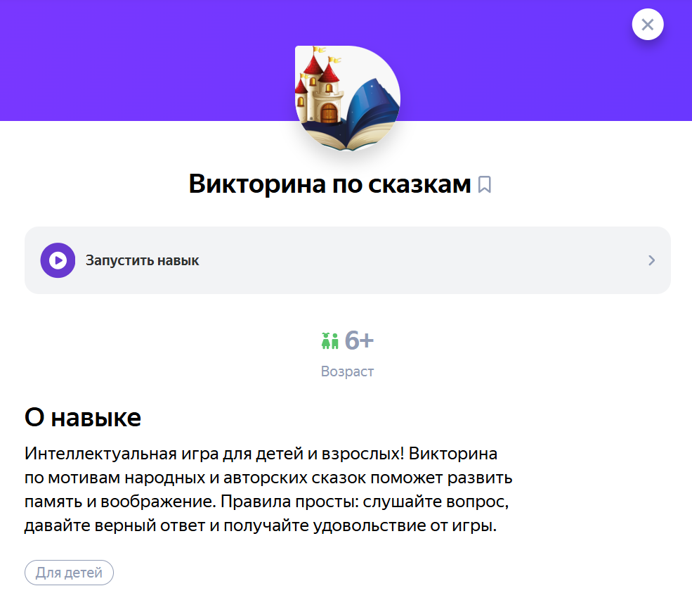
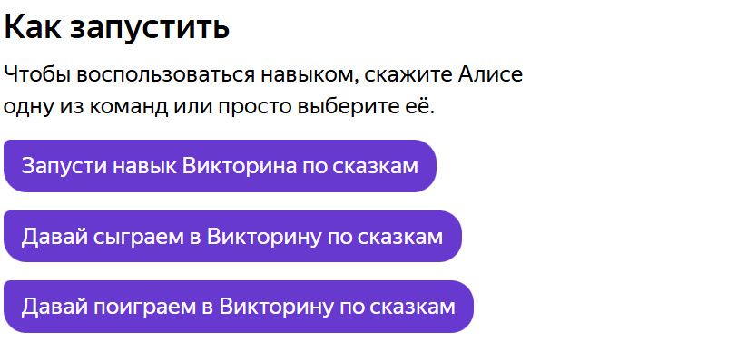
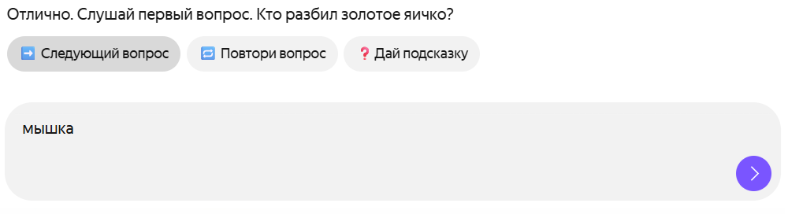

# About
An interactive skill for Yandex Alice that assesses how well kids understand fairy tales.

### URL
https://alice.ya.ru/s/8070abca-f39f-40ec-bc59-377070bed8b8

### Available on
- PCs
- Smartphones
- Yandex stations

### Game modes
The skill starts with the mode selection menu. Three modes are available:

- **Question and answer** — the skill asks a question about a fairy tale and the user answers by voice.
  Hints, repeating and skipping the question are available.
- **Guess the sound** — the skill plays an audio fragment and the user guesses the fairy tale.
- **True or false** — the skill reads a statement about a fairy tale and the user says whether it is true.

The selected mode is stored on the device and resumed in the next turn of the dialog.
To switch the mode, say «Алиса, другой режим» or «Алиса, расскажи про режимы».

### Commands
| Say | Action |
| --- | --- |
| Алиса, помоги | a hint |
| Алиса, повтори вопрос | repeat the question |
| Алиса, следующий вопрос | skip the question |
| Алиса, другой режим | change the game mode |
| стоп / хватит | exit |

### Screens

  

    

    
    

    
    

    
    

    
    

    
    

    
  

